

  

<h1 align="center">VergissMeinNicht</h1>

  
  

  <a href="#features">Features</a> ·
  <a href="#screenshots">Screenshots</a> ·
  <a href="#themes">Themes</a> ·
  <a href="#documentation">Documentation</a>

**Remember the work. Keep the history.**

VergissMeinNicht (VMN) is a self-hosted workspace for routines, shared responsibilities and the information behind them.

Turn repeatable work into **Procedures**, see what needs attention, and keep a record of who did what and when. Each Workspace uses only the tools it needs.

  <a href="assets/screenshots/readme-2026-10-28/today-memento.webp">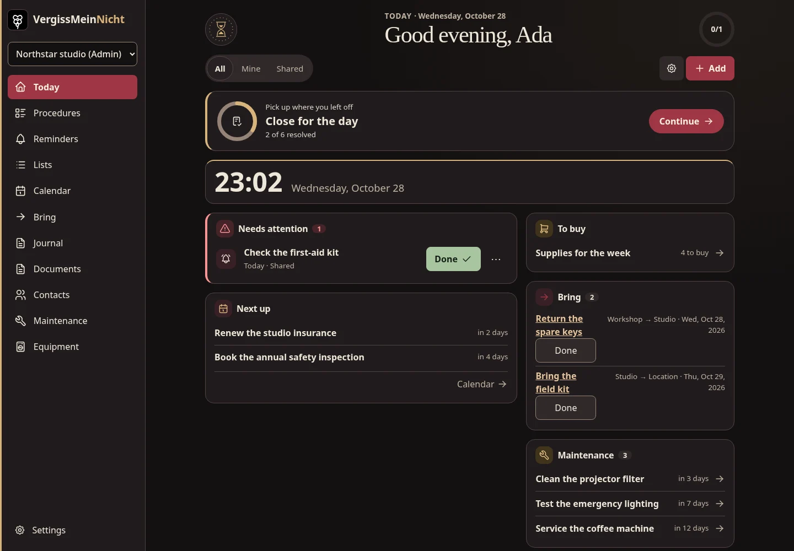</a>

## Features

| Tool / capability | What it does |
|---|---|
| **Today** | Due dates, active Runs and next actions, arranged in your own card layout. |
| **Procedures & Runs** | Reusable instructions and guided execution. History keeps the actor, time and original instructions after later edits. |
| **Reminders & Calendar** | One-off and recurring obligations, optional assignment, email and Telegram reminders. |
| **Lists & Bring** | Shared grocery lists and reminders for things to take between places. |
| **Documents** | Folders, original files, previews and text recognition on your own server. |
| **Contacts** | Shared people and organisations, links, CSV and vCard import/export. |
| **Equipment & Maintenance** | Models, compatible replacement parts, linked manuals and servicing records. |
| **Journal** | Shared Workspace notes and separate, account-private notes. |
| **Workspaces & roles** | Enable tools as needed; give members Guest, User, Editor or Admin access. |
| **Backup & restore** | Workspace-admin exports; server-admin restore into a new Workspace. |
| **Offline essentials** | Saved active Runs and grocery Lists, with queued changes sent after reconnecting. |
| **Personal touches** | Themes, backgrounds, menu order and optional private points and companions. |
| **Self-hosting** | Docker deployment, SQLite, invite-only accounts and optional TOTP. |

New Workspaces start with tools off. Switching a tool off keeps its data.

## Screenshots

Real app screens, fictional **Northstar studio** data. Click any image for the full view.

### Write it once. Follow it together.

| Procedures, ready to reuse | A focused Procedure builder |
|---|---|
| [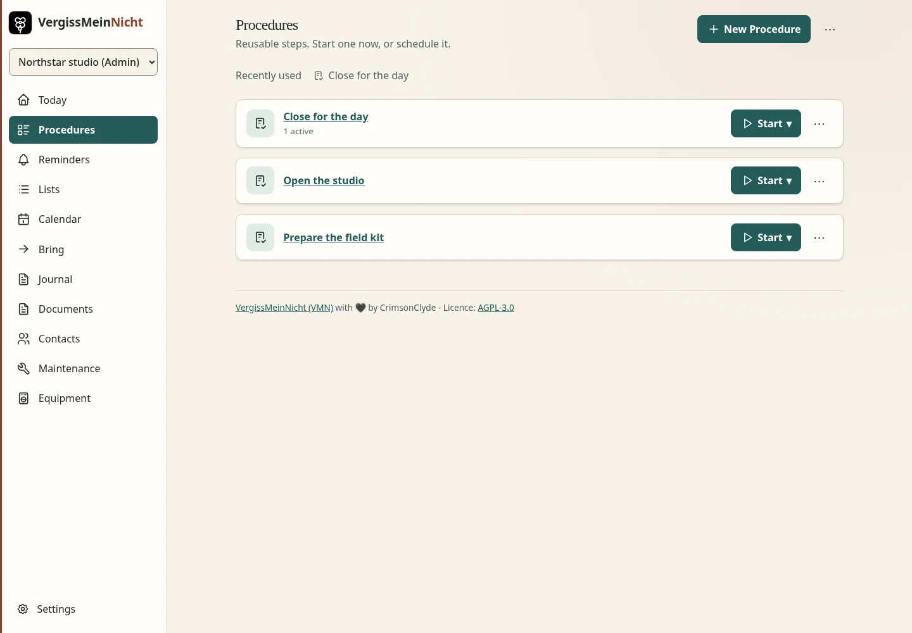](assets/screenshots/readme-2026-10-28/procedures.webp) | [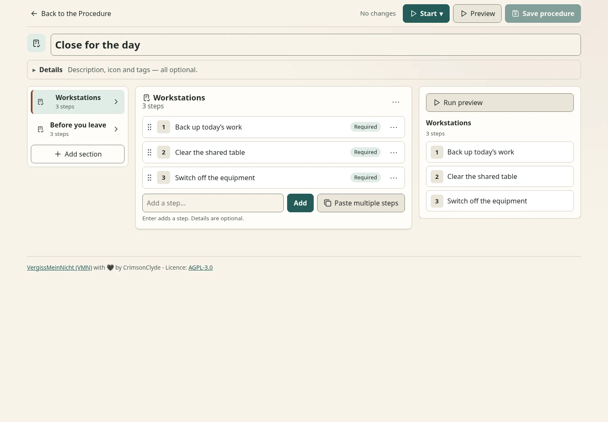](assets/screenshots/readme-2026-10-28/builder.webp) |

  <a href="assets/screenshots/readme-2026-10-28/run-phone.webp">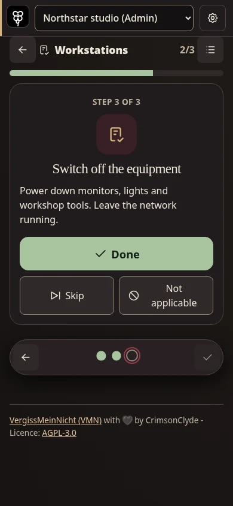</a>
  <a href="assets/screenshots/readme-2026-10-28/bring-phone.webp">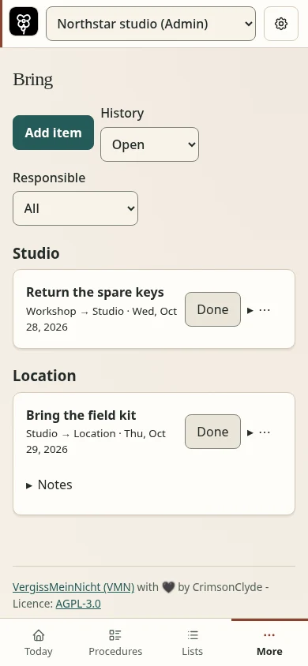</a>
  <a href="assets/screenshots/readme-2026-10-28/lists-phone.webp">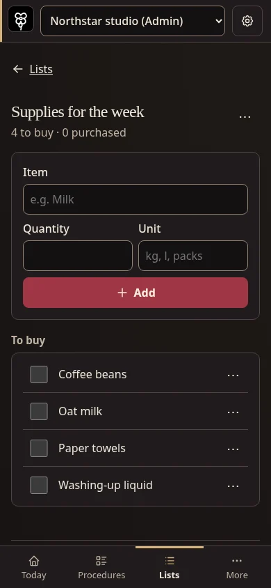</a>

Follow a Run · Remember what to bring · Pick up the supplies

### Keep the useful details close.

| Equipment & replacement parts | Documents & reference material |
|---|---|
| [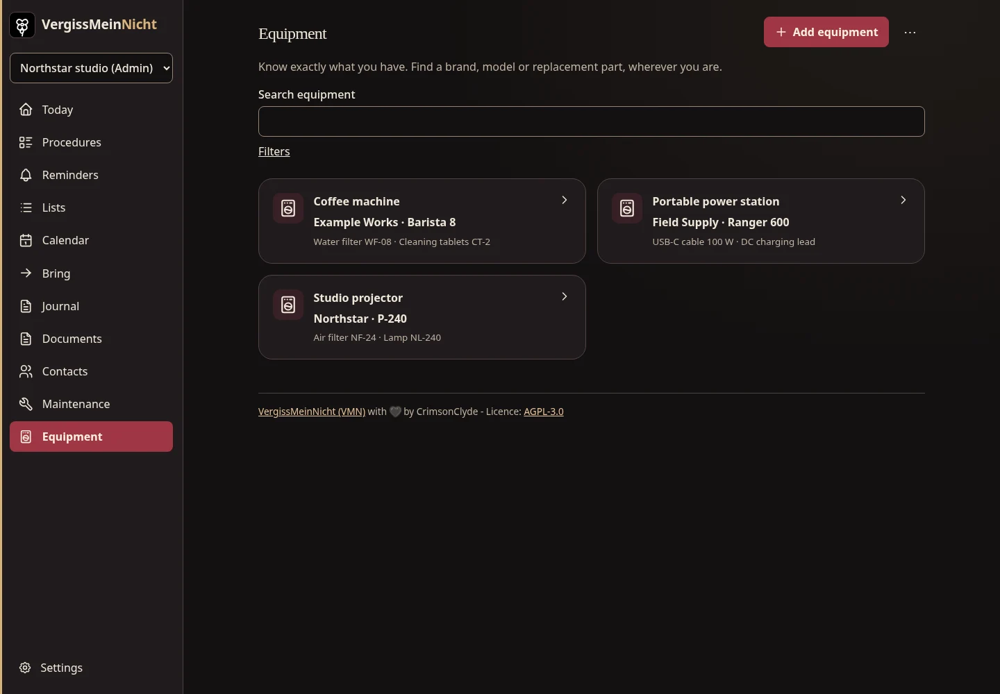](assets/screenshots/readme-2026-10-28/equipment.webp) | [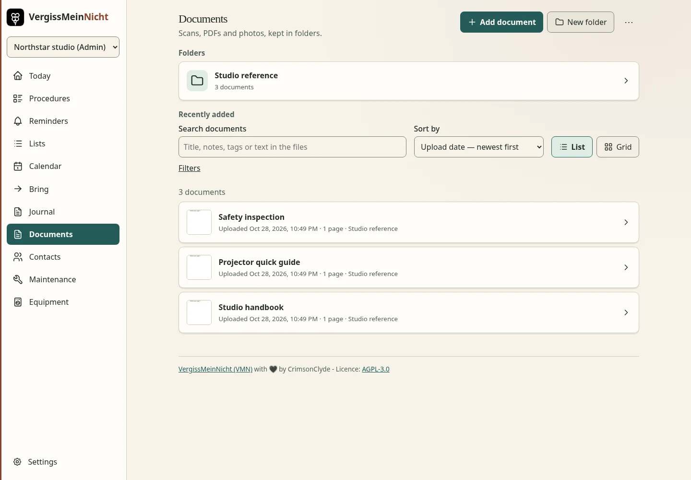](assets/screenshots/readme-2026-10-28/documents.webp) |

See the shared Journal

[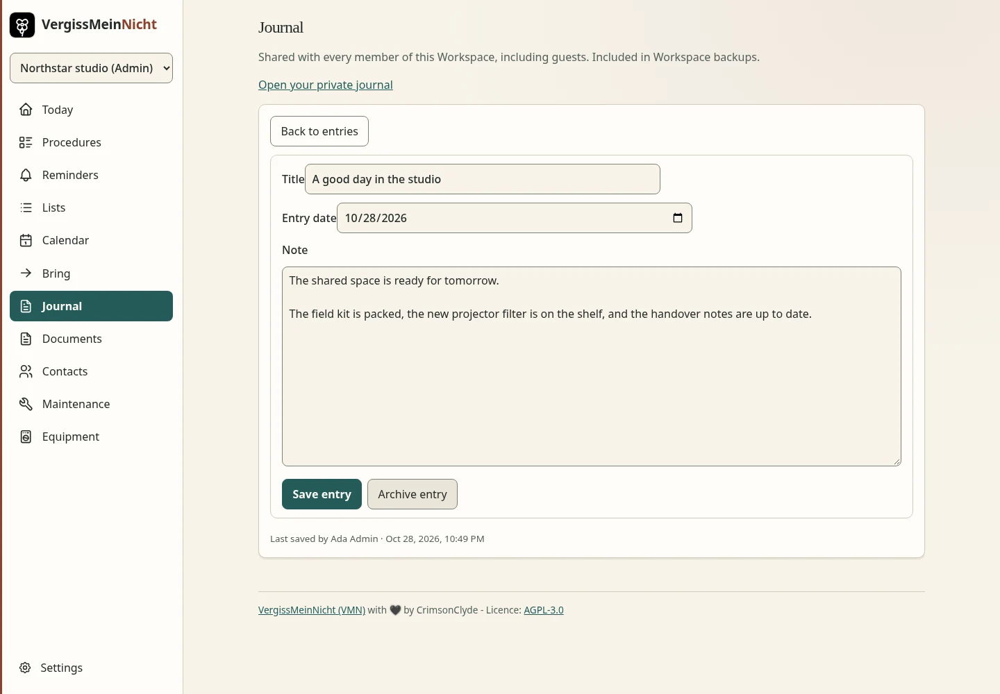](assets/screenshots/readme-2026-10-28/journal.webp)

Shared entries belong to the Workspace. Account-private entries stay separate and are excluded from Workspace backups.

## Themes

Two restrained everyday themes, with distinct palettes and quiet line-art details. **System** follows your device. Tokyo Nights, Witch Forest and the four Places remain available.

| **Memento Mori (dark)** | **Don't go into the (light)** |
|---|---|
| Warm black, bone, burgundy and candlelit brass. | Ivory, ink and deep teal, with a little daylight. |
|  | [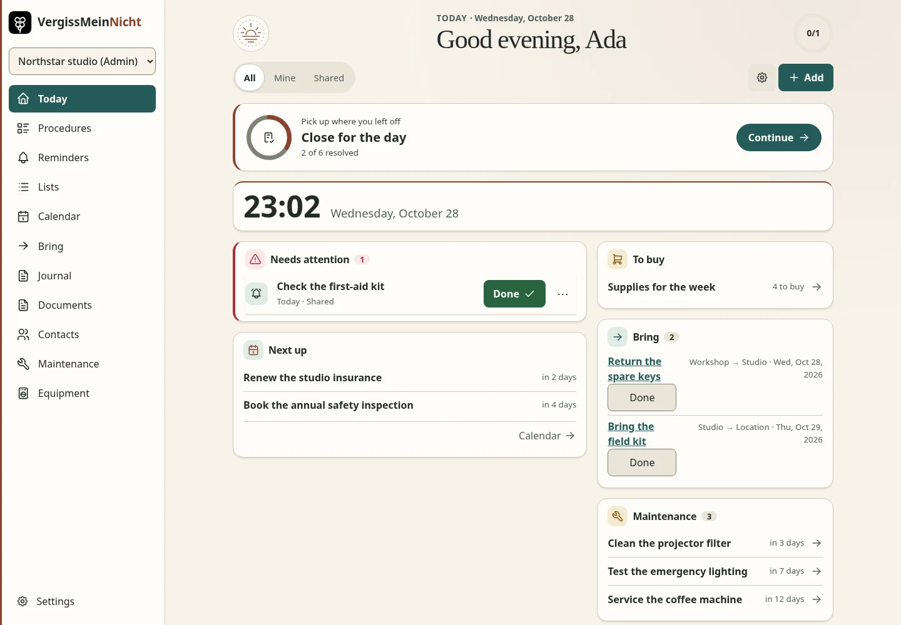](assets/screenshots/readme-2026-10-28/today-light.webp) |

Explore Tokyo Nights, the forest and Places

| Tokyo Nights | Witch Forest |
|---|---|
| [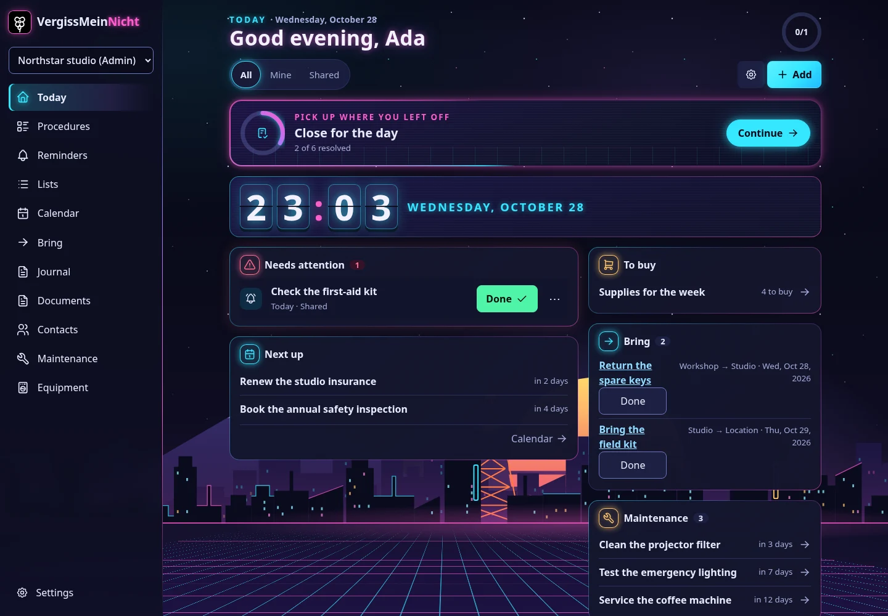](assets/screenshots/readme-2026-10-28/tokyo-nights.webp) | [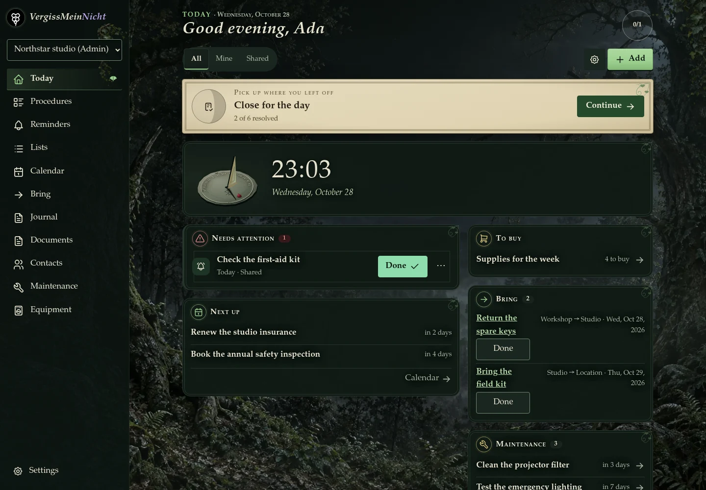](assets/screenshots/readme-2026-10-28/old-forest.webp) |

| Munich | Triora |
|---|---|
| [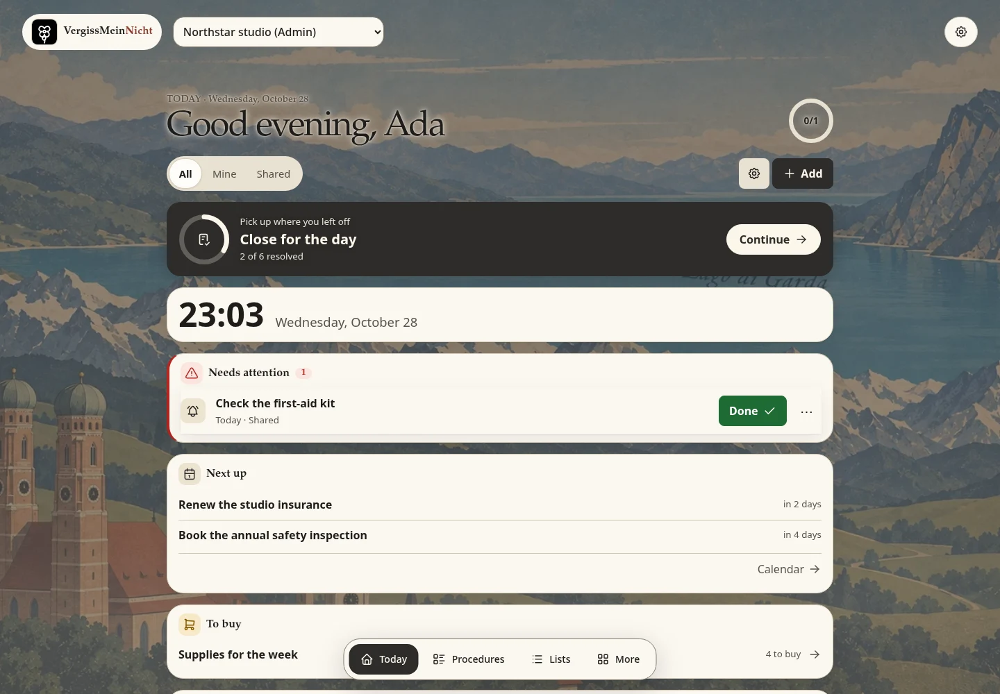](assets/screenshots/readme-2026-10-28/munich.webp) | [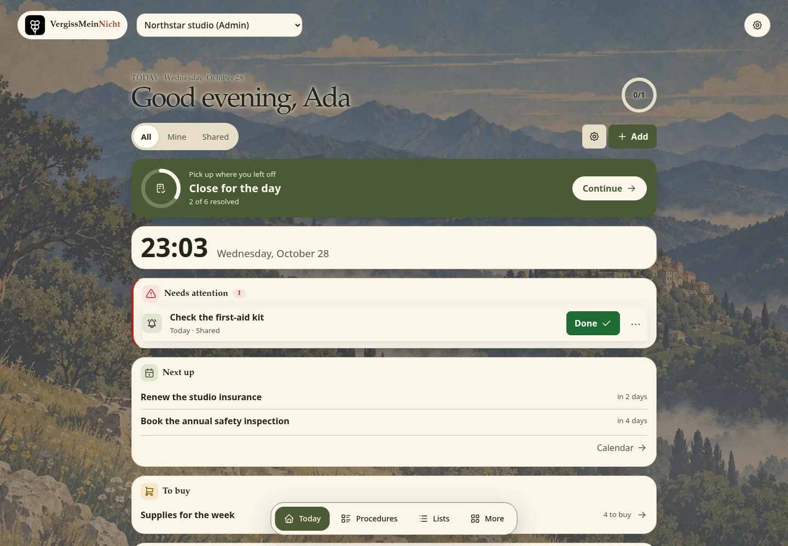](assets/screenshots/readme-2026-10-28/triora.webp) |

| London | Scotland |
|---|---|
| [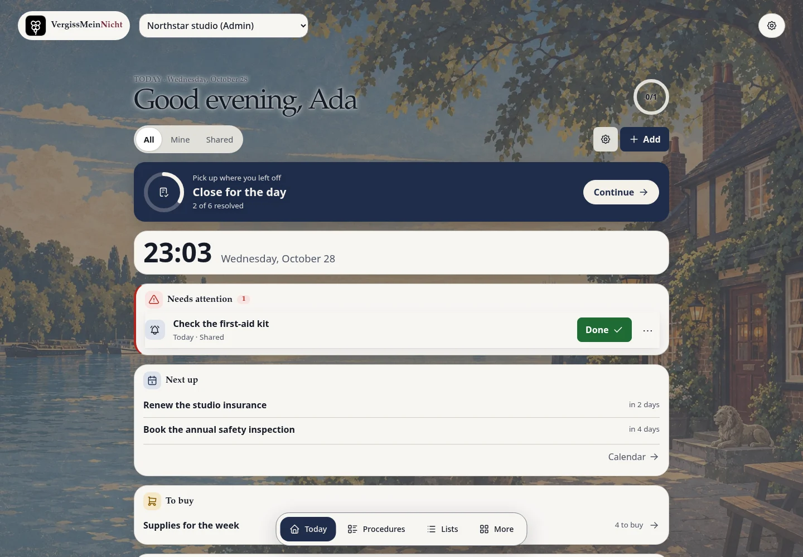](assets/screenshots/readme-2026-10-28/london.webp) | [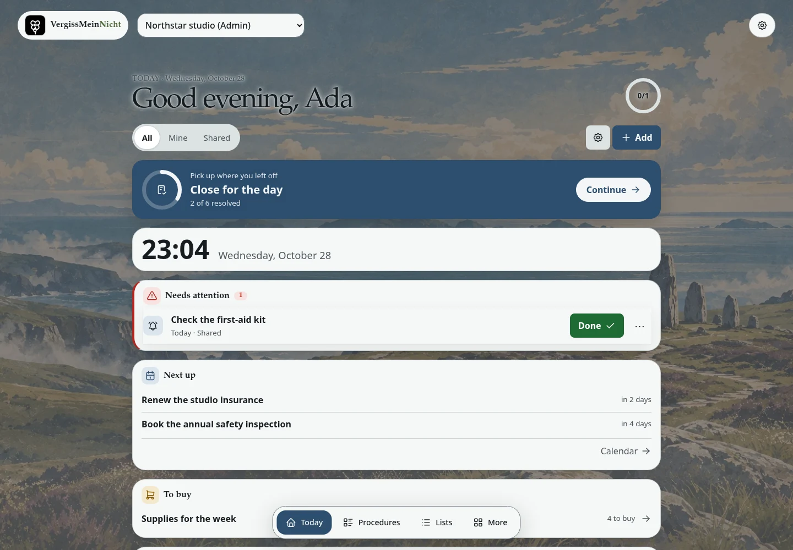](assets/screenshots/readme-2026-10-28/scotland.webp) |

Places also supports a personal background photo or no image. Decorative motion respects reduced-motion settings.

[Capture details and checks](assets/screenshots/readme-2026-10-28/README.md).

## Documentation

| I want to… | Start here |
|---|---|
| Use VMN | [User documentation](docs/user/README.md) |
| Install, configure or maintain an instance | [Admin documentation](docs/admin/README.md) |
| Contribute or develop locally | [Development documentation](docs/development/README.md) |
| Check planned work and known limitations | [Project steps](docs/development/steps.md) |
| Review security policies | [Security policy](docs/development/security.md) |

Browse all guides in the [documentation index](docs/README.md).

## Project status

**VMN is in beta.**

Features in this README describe the current source tree; published releases can lag behind it.

See the [implementation ledger](docs/development/steps.md) for release details, known limitations and upcoming work.

## The name

*Vergissmeinnicht* is German for the **forget-me-not** flower — literally “forget me not.” Say it like **fair-GISS-mine-nikht**. The knotted stem in the logo is a **Forget-Me-Knot**, like a string tied around a finger as a reminder.

## License

Made with 🖤 by CrimsonClyde. Licensed under [GNU AGPL v3](LICENSE) (`AGPL-3.0-only`). If you run a modified version for others over a network, offer its source code; configuration is covered in the [admin guide](docs/admin/deployment.md).

Bundled third-party software, including [Tabler Icons](https://tabler.io/icons) (MIT), is listed with its license texts at `/third-party-notices.txt` in each running instance.
