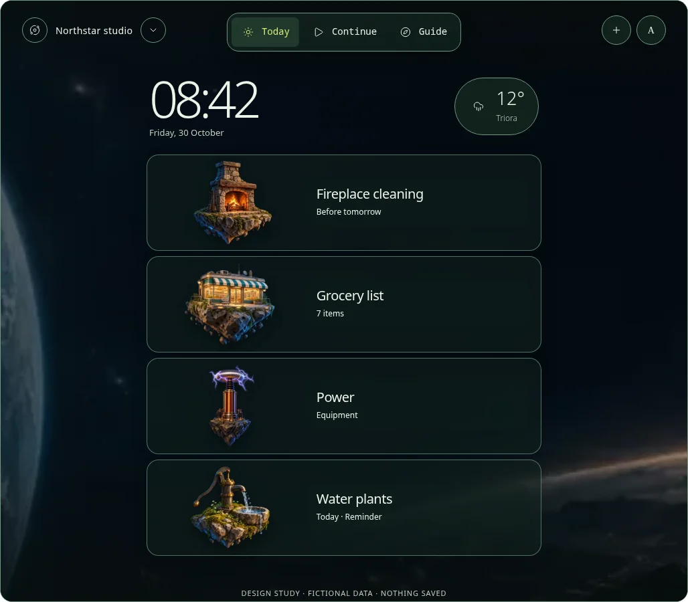
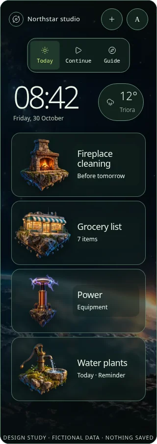
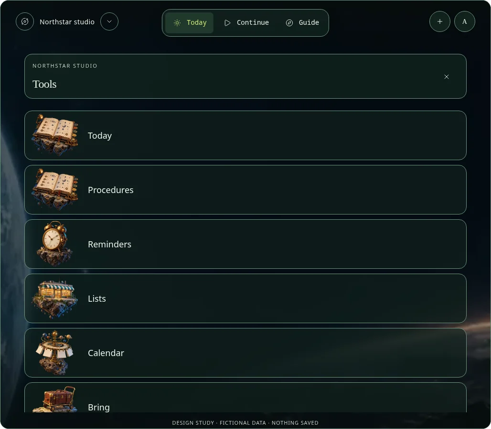
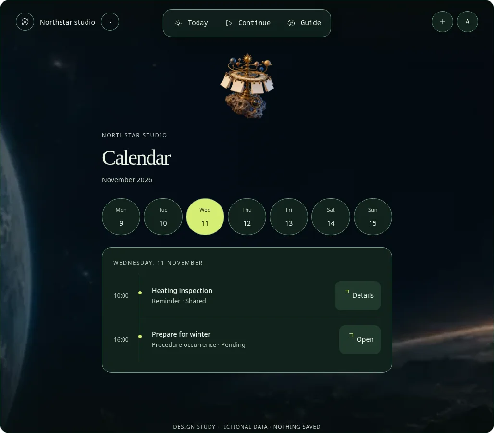
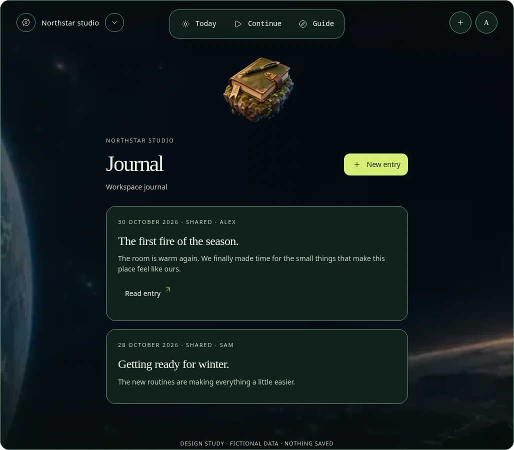
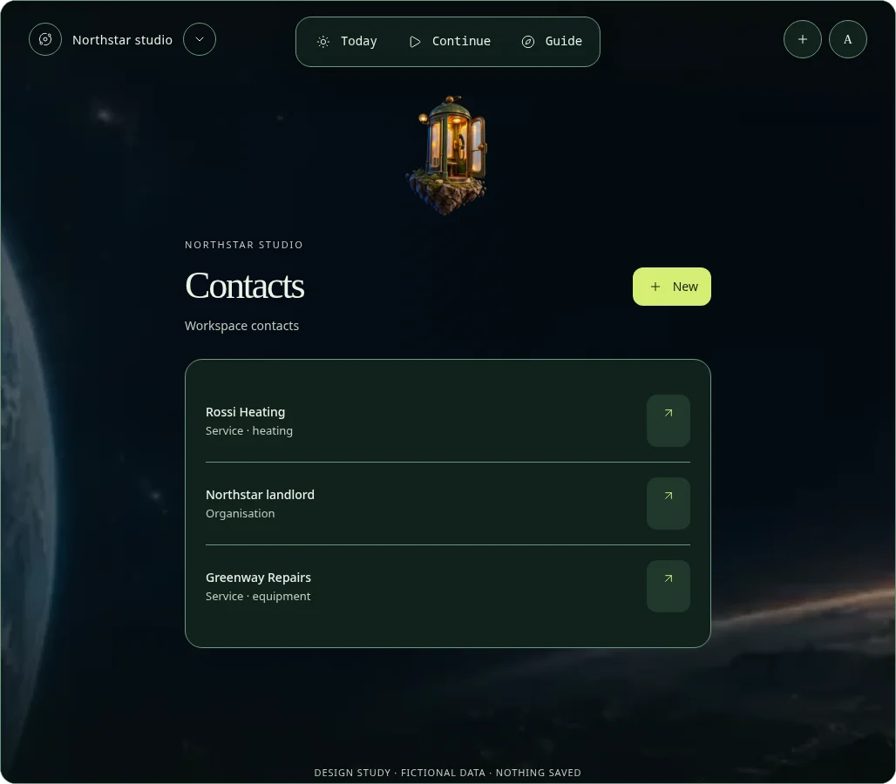

# Release 42 — full interactive Guide prototype

**Status:** isolated design prototype complete for review, 2026-10-30. The owner explicitly chose **finish the full interactive prototype first**; production implementation remains unapproved. The creative reference is *The Hitchhiker’s Guide to the Galaxy*: an eccentric galactic guidebook, a one-column reading order, recognizable floating everyday objects and concise labels. The latest owner-requested revision puts each image **inside a translucent card**, removes the visible **DON'T PANIC and 42 marks**, and moves the menu to the top. The release milestone ordinal remains unchanged in project documentation.

The interactive version is presented in the design chat. It contains fictional Northstar studio data and local-only interactions. Neither the application nor any real Workspace is changed. The [approved reference](space-interface-concept.png), [readiness audit](readiness-audit.md) and earlier [interaction studies](interaction-directions.md) remain available.

## Floating objects and existing meanings

The Space cards now use translucent semantic surfaces with the existing scene visible through them. The images stay within the card bounds and the captions retain a stronger readable surface. The tool chooser follows the same card treatment. Top navigation sits in the desktop header and above the content on phones; its reading/tab order also precedes the main content. Forced colors uses solid system surfaces. No new artwork was generated for this revision, and the earlier studies remain preserved.

| Illustration | Meaning in the prototype |
| --- | --- |
| Fireplace on a rock | Continue the fictional fireplace-cleaning Run |
| Supermarket on a rock | Grocery List |
| Tesla coil | Power as an Equipment illustration; no new power tool or monitoring |
| Water pump | Water plants, an ordinary Reminder; no water metering or new utility tool |
| Open field guide | Procedures; also the structural Today entry |
| Alarm clock | Reminders and the Clock view |
| Orrery/calendar leaves | Existing Calendar/agenda |
| Travel trunk | Bring |
| Diary and pen | Shared Journal; the separate private Journal is reached through Profile |
| Filing cabinet | Documents |
| Telephone booth | Contacts |
| Repair workshop | Maintenance |

All illustrations are original generated cutouts on transparent backgrounds. Objects float directly in the Space scene; they are not photographs of user records or evidence of completed work. They add no domain field, upload, automatic image-generation capability or external application service. Other themes retain their own scenery or neutral surfaces with the same destinations and actions; No image suppresses decorative imagery. The Space identity is optional.

## What can be explored

- **Complete destination map:** Today, Procedures, Reminders, Lists, Calendar, Bring, Journal, Documents, Contacts, Maintenance and Equipment; Clock/Weather views, history, Trash, Profile, Workspace settings, private Journal and an account-security overview. The Guide chooser uses one illustrated column and a reachable close control.
- **Guided execution:** seven fictional Steps with Previous/Next, an All steps overview, Done, Undo, distinct Skipped/Not applicable with a required local reason, and completion blocked while Steps remain Pending. Completion appears in the local history preview. Nothing is sent, audited, rewarded or saved in VMN.
- **Local creation:** select an existing kind, enter a title/notes and add it to the current preview. Text is escaped. Private-Journal entries are kept in a separate local collection from shared Journal entries; this demonstrates presentation separation, not new authorization behavior.
- **Other representative interactions:** Grocery checks, a Water plants reminder and selected Bring/Maintenance/Reminder status controls; calendar date selection and existing record-detail surfaces.
- **Appearance:** Space, System, the everyday Light/Memento pair, Tokyo Nights, Witch Forest, all four Places, a sample photo substitute and No image. Profile also offers a current-interface fallback **sketch**, not the real application or an implemented rollout feature.

The prototype covers the whole interface at design-review breadth. It does **not** simulate every production command, file parser, invitation, MFA/recovery operation, import/export/restore, real collaboration, offline replay or role/tool-gate combination. Security settings show fictional non-secret status only. These existing capabilities must be preserved and designed in detail before production work; no secrets, QR seeds, credentials or live account data are used here. This is not permission to simplify existing security or historical behavior.

| Phone | Guide chooser |
| --- | --- |
|  |  |

| Calendar | Journal | Contacts |
| --- | --- | --- |
|  |  |  |

## Verification and limits

The local Chromium walkthrough checks all 13 Guide choices (11 structural/navigable destinations plus Clock and Weather), Water reminder navigation/status, contextual creation and literal HTML-like text, List checks, seven-Step reasons/Undo/completion blocking/history, private/shared Journal separation and the account-security overview. It checks 12 appearance choices, fallback switching and representative desktop/390/320 px layouts with no horizontal overflow or page errors.

Sixteen app-surface axe A/AA scans cover Today, Guide, Run, Create, Reminder detail, Profile, private Journal and account security at desktop and 320 px. They pass with no violations. Escape, forced colors and reduced motion (zero running animations) were checked. The bundled standalone renderer loads three approved static CDN scripts (Floating UI core/dom and Lucide); no unexpected, application or forecast-provider requests were observed. These are prototype checks, not production authentication, accessibility, phone-device or screen-reader certification.

Image alpha/integrity, documentation links/JSON, unchanged approved-reference SHA-256, JavaScript syntax, whitespace and documentation-only Git scope were checked. The inline source is below 1 MB. Desktop/phone/chooser and representative tool captures were visually inspected. The production suite/build/container scans were not rerun because no production source, dependency, schema or configuration changed.

## Artwork provenance

The built-in image-generation tool produced the three initial floating cutouts ([prompts](directions/constellation-floating-prompts.json)) and nine extension illustrations ([prompts and generated filenames](directions/full-guide-object-prompts.json)). These are exploratory assets, not final approved artwork. Alpha-preserving WebP review assets live beside this document's captures:

- [Fireplace](directions/constellation-floating-fireplace.webp), [supermarket](directions/constellation-floating-market.webp), [Tesla coil](directions/constellation-floating-power.webp).
- [Water pump](directions/guide-water.webp), [Procedure guide](directions/guide-procedures.webp), [alarm clock](directions/guide-reminders.webp), [calendar](directions/guide-calendar.webp), [Bring trunk](directions/guide-bring.webp), [Journal](directions/guide-journal.webp), [Documents archive](directions/guide-documents.webp), [Contacts booth](directions/guide-contacts.webp), [Maintenance workshop](directions/guide-maintenance.webp).

**Security surface changed:** NO. **Security policy update:** N/A. **Remaining:** owner review of visual direction and detailed production interaction/accessibility/theme/fallback specification. No merge, production redesign, migration, tag, image publication, release or deployment; owner count remains 41 and the special 42nd stays reserved.
