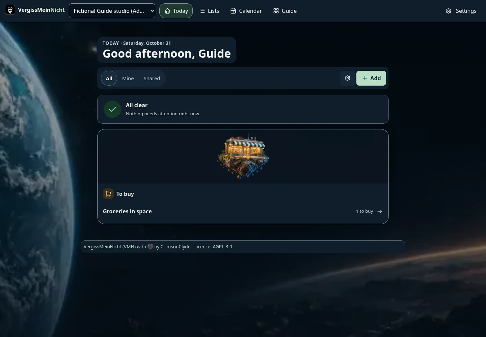
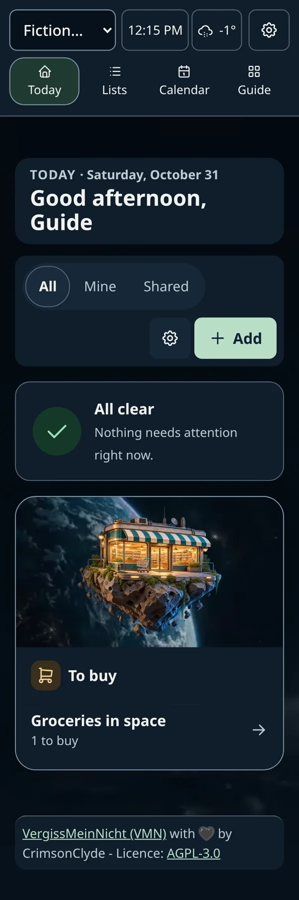
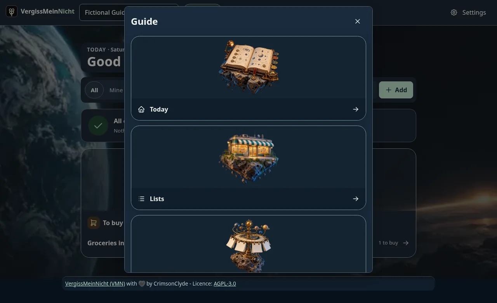

# Guide implementation — 2026-10-31

The owner authorized implementation after reviewing the prototype and plan. Guide is now the default authenticated interface across themes, with the optional **Galactic Guide** theme and an explicit **Existing interface** fallback in Profile → Appearance. No release, merge or deployment has been performed; owner count remains 41, next special 42nd.

The top bar keeps Workspace/Settings, enabled personal shortcuts and a labelled Guide opening all enabled tools in saved order. Existing addresses and tool/security boundaries remain. Today keeps all registered cards and personal choices in one column. Space uses bounded floating-object artwork inside translucent cards; other themes keep their own decoration. Clock/Weather move to the header only when personally enabled and open larger views; forecast configuration/full details remains at its existing address.

Appearance stores private account-wide Guide/classic, Glass/Starfield, 0–100% background opacity and images-on/off choices with explicit Save/Cancel/reset. Text/control surfaces remain protected. Places retains its existing private per-Workspace settings. A validated Guide/menu-order device copy preserves offline reload and uses existing account-switch/sign-out cleanup. No credentials, remote assets, provider, API endpoint or upload path is added.

| Phone | Guide chooser |
| --- | --- |
|  |  |

Migration **0060_space_guide** extends the two personal theme allowlists and adds bounded settings, preserving old values and SQL guards. Populated migration and Workspace backup/restore tests pass; personal settings remain excluded from Workspace packages. Use the normal pre-upgrade backup/migration procedure; never run an older incompatible server against a migrated database.

Validation: lint, repository typecheck and production build pass. Full Vitest: **200 files / 1,539 tests passed**. Full Playwright: **13 passed / 1 intentional mobile bootstrap skip**; the final Guide-only desktop/phone rerun passes after the settings-menu/reading-surface and offline-order refinements. Coverage includes all current theme identifiers/legacy dark, 320/390/1440 layouts, axe, keyboard/focus/Back, disabled destinations, private setting persistence, offline reload, cached weather fixtures, no-image/opacity endpoints, forced colors/reduced motion and CSP/no external requests. The long existing account flow preserves authoring/import/export/Run/offline/TOTP/recovery behavior in the existing interface. Browser Guide fixtures run in a separate disposable database/server to avoid changing bootstrap expectations. No live providers or real user data were used.

**Security surface:** LOW — bounded private presentation persistence; dedicated API/SQL negatives and the [security checklist](../../development/security.md) are updated. Artwork source/provenance and size details are in `apps/web/src/guide/ARTWORK.md`; every cutout is below 150 KB and the backdrop is 7.2 KB, with lazy image loading. The build reports a main JavaScript chunk above 500 KB; no modest-device performance certification is claimed. Physical iOS/Android, screen-reader and 400% zoom review, deployment fallback rehearsal and native release-image scans/signing remain release-candidate work. The current task publishes nothing.
