# Release 42 — three interaction studies

**Status:** design exploration, 2026-10-30. The owner approved preparing several interaction concepts covering the whole experience, with beauty and design as the emphasis. Existing themes should work with the new interaction model, and the current interface should remain available as a fallback if feasible. No production redesign, final navigation choice, release or deployment is authorized by these studies.

The interactive comparison is presented in the design chat. All records, actions and dates in it are fictional; interactions change only local preview state. The original [approved mockup](space-interface-concept.png) remains unchanged. These are three alternatives for discussion, not three themes or three implementations to ship.

## Horizon

An open landscape, a large clock and a concise group of things needing attention. A floating labelled dock anchors the experience; More opens the complete tool chooser. Independent Clock and Weather views leave room for the artwork. Guided execution uses a single large instruction and an explicit action; Calendar keeps a quiet agenda.

**Strength:** direct everyday use and clear orientation with a large scenic canvas. **Tradeoff:** a permanent dock uses some of that canvas and resembles the established Places pattern. **Question for review:** is the balance between atmosphere and task visibility right?

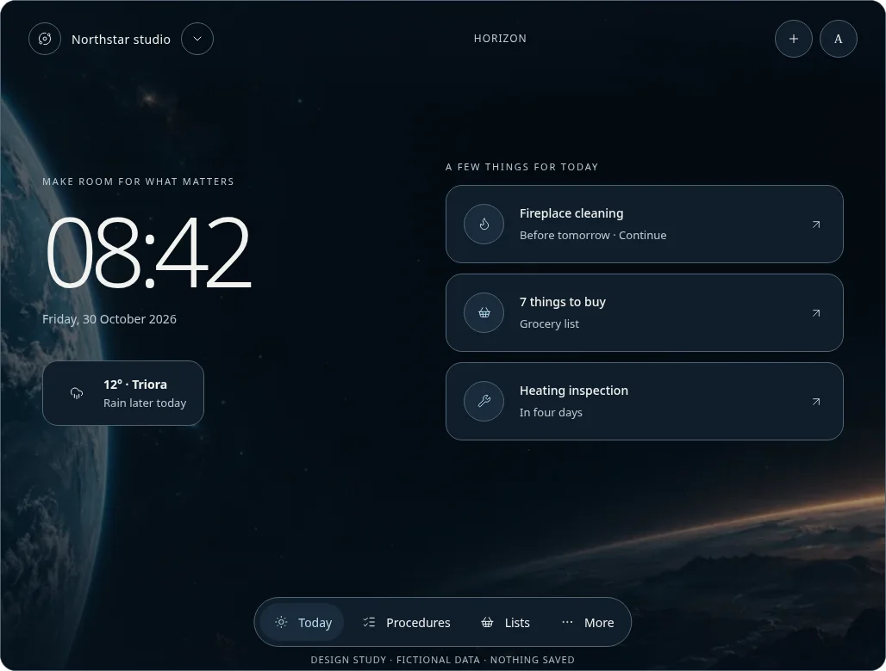

## Atelier

An editorial composition: generous typography, a small weather object and a short, numbered reading sequence of next actions. A full tool curtain replaces a permanent catalogue of destinations. A restrained footer offers Today, Calendar and All tools. Individual tools become reading and working spaces rather than dashboard cards.

**Strength:** calm hierarchy and character that translates naturally to the everyday Light/Memento themes. **Tradeoff:** the large heading uses space and tool switching usually opens the chooser. **Question for review:** does the more literary tone feel useful and personal, or too decorative for daily work?

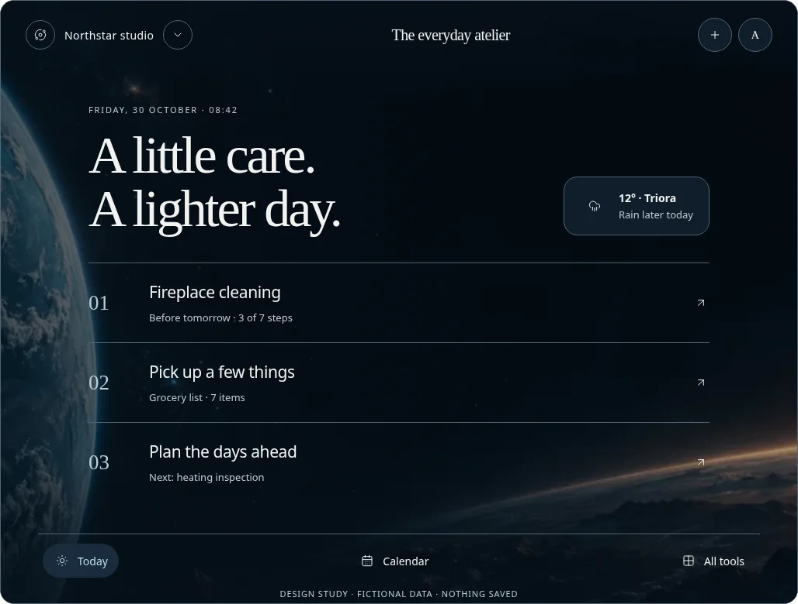

## Constellation

A clock at the center of a quiet orbital composition, with labelled objects for relevant tasks. Explore opens the entire tool collection; Continue keeps active execution close at hand. The spatial metaphor is decoration around ordinary labelled controls and logical reading order. Other themes use the same layout with their own materials and colors.

**Strength:** closest to the reference's sense of discovery and atmosphere. **Tradeoff:** spatial discovery needs more usability review and careful small-screen composition. The study deliberately avoids making unlabeled planets or gestures the only way to navigate. **Question for review:** is this distinctive enough to justify its extra visual complexity?

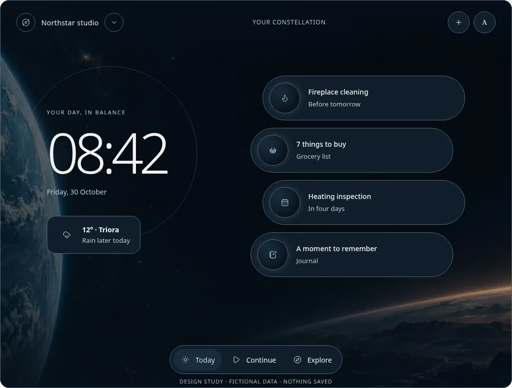

### Constellation refinement — one column, more imagery, less text

**Required creative reference, clarified by the owner:** *The Hitchhiker’s Guide to the Galaxy*, not generic space decoration. The revised Space presentation explores an eccentric galactic guidebook: a restrained **DON’T PANIC** masthead, decorative 42 mark, retro electronic typography, tactile green/graphite controls and a Guide tool chooser. Everyday tool names, actions, due dates and permissions remain clear; imagery supports the Guide identity. This is an original exploratory interpretation, not a reproduction of a film interface or approval for production implementation.

The owner favored Constellation for further exploration and requested trying one column with more images and less text. The revised local study uses a single reading column on desktop and phone, a compact clock/weather glance, and three larger planetary-image cards. Each card keeps its title and one short due/count line; longer context stays in the tool views. Other page headings are shortened, the Procedure collection uses a single column and the guided Step has a larger illustrative surface while retaining its instruction text.

The illustrative cards use copper, jade and ice-blue planets with subtle labelled tool symbols inside the Guide presentation. Planet artwork and Guide styling are confined to Space; other appearance previews reuse their own scenic background or neutral surfaces with the same controls. No image suppresses decorative card imagery. This is still a design study, not final artwork or approval for a new upload, automatic image-generation feature or data model.

| Desktop | Phone |
| --- | --- |
| 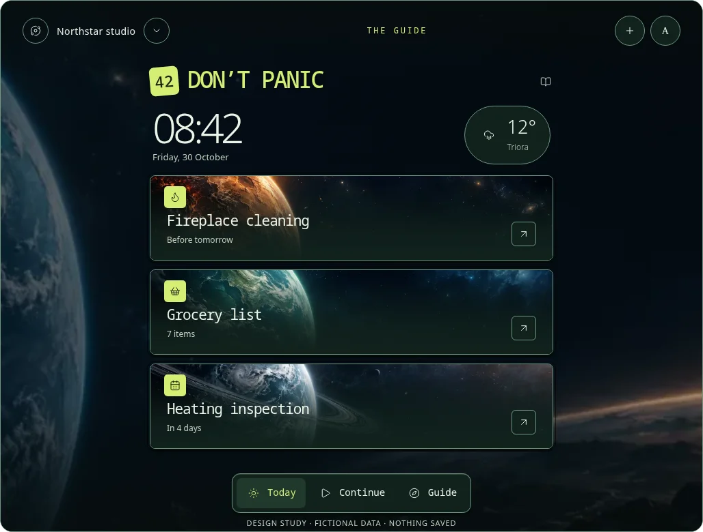 | 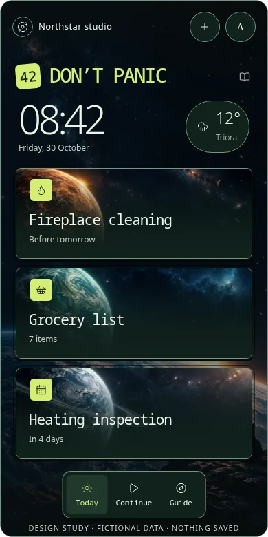 |

Exploratory image assets: [copper](directions/constellation-world-copper.webp), [jade](directions/constellation-world-jade.webp), [ice](directions/constellation-world-ice.webp). Generated with the built-in image tool; exact [prompts and purpose](directions/constellation-image-prompts.json) are recorded. The original three-way comparison and approved reference remain unchanged.

**Checks for this iteration:** desktop and 390/320 px views, all listed tool destinations and 12 appearance choices, local List/Run feedback, fallback and zero page errors; no horizontal overflow in checked views. Four app-surface axe A/AA scans (home/chooser at desktop and 320 px) passed; Escape, zero active animations under reduced motion and forced colors checked. Desktop/phone captures visually inspected. Production behavior and security surface remain unchanged; final feature/theme/accessibility acceptance is still outstanding.

## Phone compositions

Each direction reflows independently on phones: Horizon stacks the clock and task group; Atelier becomes a short editorial reading sequence; Constellation becomes labelled orbital objects beneath the clock. Touch controls remain ordinary buttons. Reduced motion requires no motion to understand or navigate the study.

| Horizon | Atelier | Constellation |
| --- | --- | --- |
| 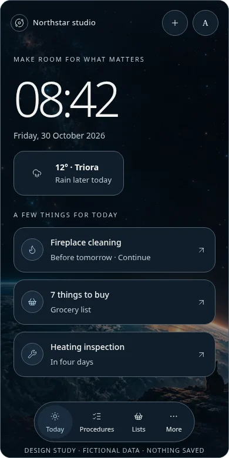 | 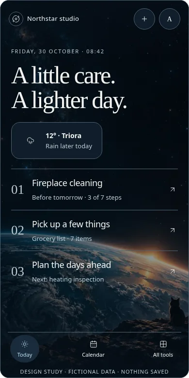 | 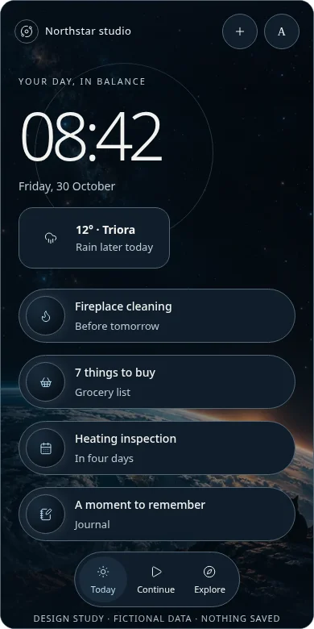 |

## Coverage and boundaries

The preview covers Today, Clock, Weather, Procedures, guided Run, Calendar, Lists, Bring, Journal, Documents, Contacts, Maintenance, Equipment, history, Trash, profile, Workspace settings and a local creation surface. Tool collection, detail overlays, account appearance and a fallback sketch are navigable in each direction. This is breadth of design coverage, not production functionality or complete parity certification: settings/security, authoring, import/export/backup and record-detail workflows still need detailed design using their existing authorized flows.

Theme controls demonstrate Space, System, the everyday Light/Memento pair, Tokyo Nights, Witch Forest, all four Places, a sample personal-photo background and No image. Persisted `dark` remains an application alias of Memento; the study changes no saved identifier. Existing scenic artwork is reused only in this preview; current animations and personal photographs are not imported or processed. The sample photo option uses bundled Triora art, not a person's real photograph. Final theme fidelity, phone crop choices and all theme/state combinations remain implementation validation work.

The fallback is a **layout sketch** showing the feasibility and reachability goal, not an embedded copy of the current application. Switching it changes only local prototype presentation. It neither migrates user preferences nor promises an implemented rollout mechanism.

### Independent views and theme examples

| Weather | Guided Run | Calendar |
| --- | --- | --- |
| 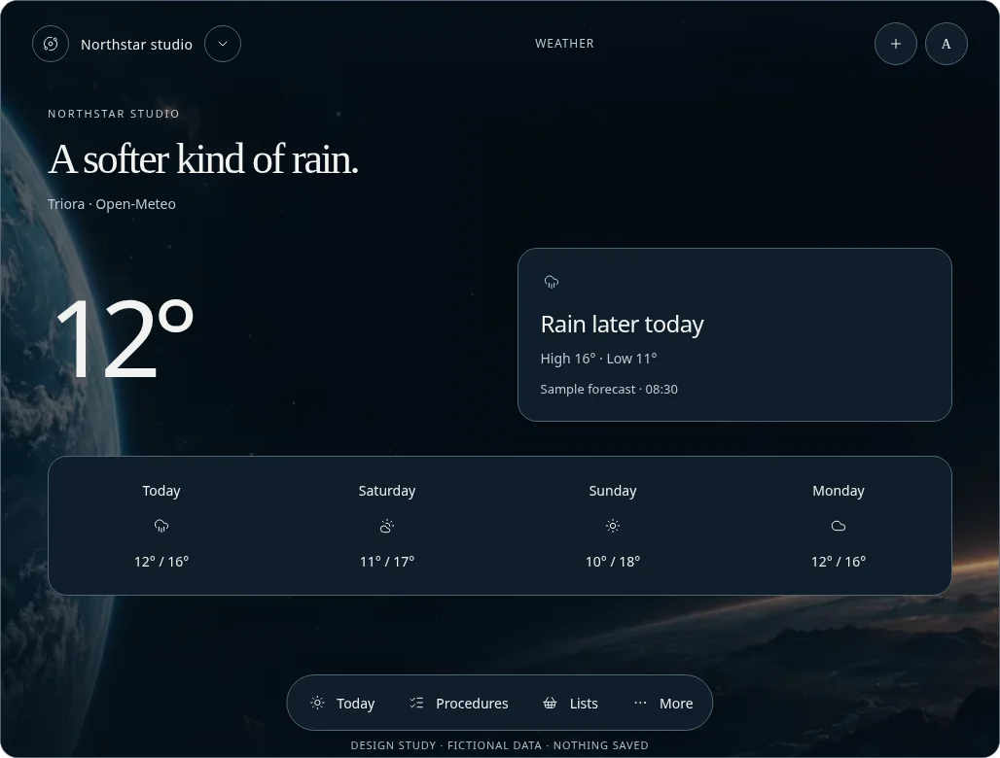 | 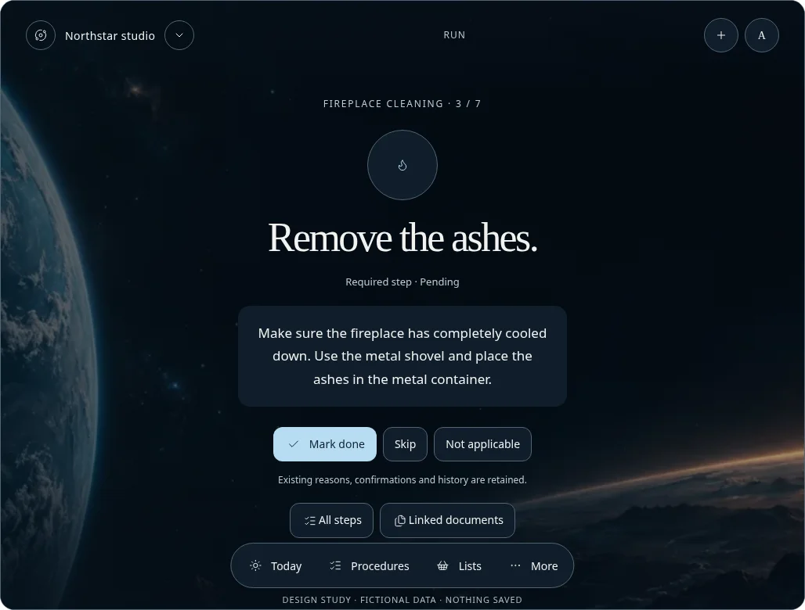 | 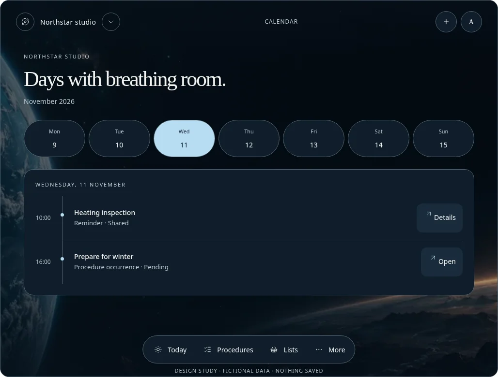 |

| Everyday Light | Witch Forest |
| --- | --- |
| 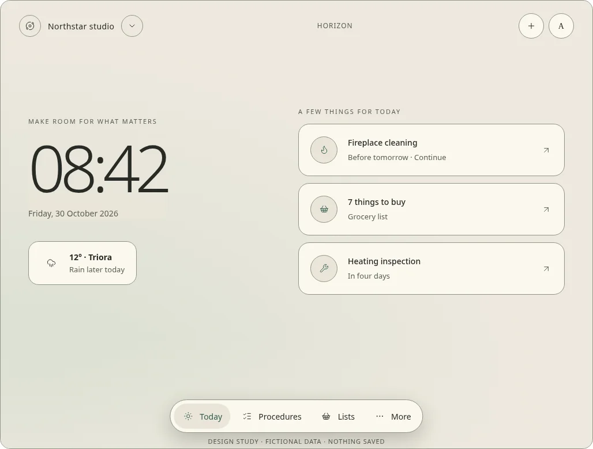 | 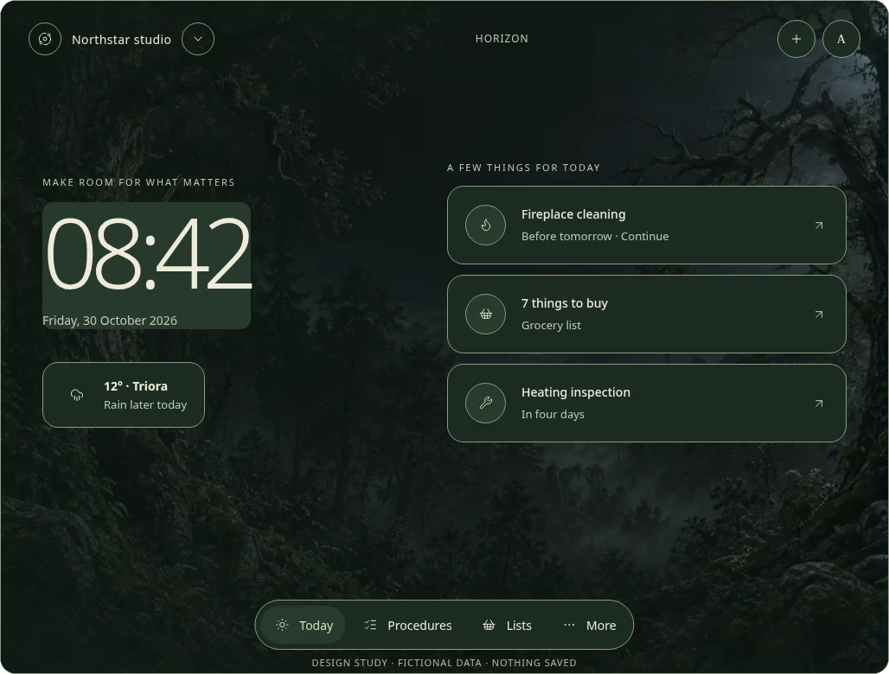 |

Lists can be checked and a guided Step toggled locally; these interactions demonstrate feedback only. No backend request, shared mutation, real Save, attachment, upload, provider call, tracking, AI action or new domain behavior occurs. Search is intentionally not represented as an implemented cross-tool service. The study keeps all tools enabled for visual coverage; disabled-tool/role variants remain a subsequent specification and test requirement.

## Artwork provenance

New Space background illustrations were generated with the built-in image-generation tool for this exploration. The exact approved reference was not edited. The generated output is a new atmosphere study, not final approved production artwork. The desktop and portrait assets are held with this chat's design preview; the images below are browser captures of that preview, converted to WebP for documentation.

Desktop prompt:

> Use case: stylized-concept. Asset type: panoramic background for an interactive design-only prototype of VergissMeinNicht, a serious procedures/reminders app. Primary request: sophisticated cinematic deep-space atmosphere, enormous detailed blue planet emerging on the far left, thin warm golden planetary horizon low right, restrained tiny stars, dark navy-black empty space in the center and upper right to support readable controls. A tiny realistic seated black cat silhouette on the rocky foreground at the bottom far right, understated personality. Painterly photoreal science-fiction matte painting with film-grain, gentle teal rim light and copper dawn. Wide landscape composition, expensive art direction, quiet and contemplative, no spacecraft, no people, no interface, no lettering, no logos, no watermark, not cartoonish. Keep the entire middle 65 percent very dark and uncluttered. This is a new exploratory background, not a replacement for the owner's exact approved mockup.

Portrait prompt (desktop generated image used as a style reference):

> Use case: stylized-concept. Asset type: portrait mobile app background concept, no UI. Input image: reference for lighting, planet materials and cinematic style only. Create a new vertical portrait companion composition: dark blue-black starfield occupying upper 65 percent with quiet negative space for readable interface, a vast blue crescent planet and thin warm dawn horizon occupying the bottom quarter, tiny seated black cat on the rocky ground at the very bottom right. Expensive contemplative science-fiction matte painting, exceptionally restrained teal and warm copper atmospheric light, photoreal painterly detail. No spaceships, astronauts, buildings, text, buttons or interface. Portrait framing suitable for a phone screen, original new image, not a screenshot or collage.

## Review and remaining work

**Checks:** local browser walkthrough across all three directions, all listed tool destinations, 12 appearance choices, local List/Run feedback and fallback switching; no page errors. Home plus Weather/Calendar/Procedures/Profile checked at 390 and 320 px without horizontal overflow (a decorative orbit overflow was fixed). Twelve axe A/AA checks of mocked application home/tool-chooser surfaces passed across three directions and desktop/320 px; Escape dismissal, reduced motion (zero active animations) and forced-colors rendering checked. The bundled standalone renderer's carousel counter was separately flagged for contrast outside the application preview; it is not overridden by the study. Eleven desktop/phone/detail/theme captures were saved; representative compositions visually inspected. No production full-suite or physical-device/screen-reader certification is claimed. Final source fragment stays below the inline preview's 1 MB bound and makes no application/provider requests.

Choose a direction or describe elements to combine after exploring the full-screen and phone views. Beauty and composition are the present review focus; production behavior, authorization, offline replay, accessible semantics, full theme fidelity and a deployable fallback remain governed by the [readiness audit](readiness-audit.md). No version or release date is selected. Count remains 41; the next owner-counted release is reserved as the special 42nd.

**Security surface changed:** NO — fictional local design preview and documentation only. The normative policy remains unchanged.
